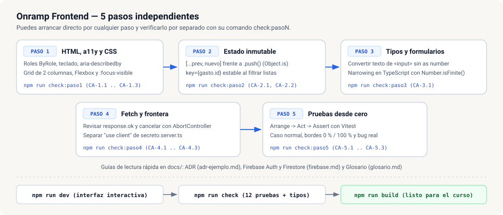

# Onramp Frontend

Este repositorio es un **onramp** práctico y autoevaluable de 60 minutos para preparar tu entrada a [frontend-course](https://github.com/ykro/frontend-course). Forma parte del índice de kits de nivelación [courses-onramp](https://github.com/ykro/courses-onramp).

El proyecto se divide en **cinco pasos independientes**. Si ya dominas HTML semántico o CSS, puedes arrancar directo en el Paso 3, el Paso 4 o el Paso 5 sin haber completado los anteriores, y verificar cada paso por separado.

## Los 5 pasos (independientes)

| Paso | Enfoque | Verificación | Guía |
| --- | --- | --- | --- |
| Paso 1 | HTML semántico, teclado, roles `ByRole`, `aria-invalid` y `aria-describedby` | `npm run check:paso1` | [steps/01-html-y-accesibilidad/README.md](steps/01-html-y-accesibilidad/README.md) |
| Paso 2 | CSS Grid de 2 columnas, Flexbox y foco visible `:focus-visible` | `npm run check:paso2` | [steps/02-css-layout-y-foco/README.md](steps/02-css-layout-y-foco/README.md) |
| Paso 3 | Estado inmutable en React (`Object.is`) y `key` estable por `id` al filtrar | `npm run check:paso3` | [steps/03-estado-inmutable/README.md](steps/03-estado-inmutable/README.md) |
| Paso 4 | Conversión segura de texto de `<input>` y narrowing en TypeScript sin `as number` | `npm run check:paso4` | [steps/04-tipos-y-formularios/README.md](steps/04-tipos-y-formularios/README.md) |
| Paso 5 | `response.ok` en `fetch`, cancelación con `AbortController` y frontera `"use client"` | `npm run check:paso5` | [steps/05-fetch-y-frontera/README.md](steps/05-fetch-y-frontera/README.md) |

## Inicio rápido

1. Clona este repositorio con Node.js 24 (definido en `.nvmrc`) e instala dependencias con `npm install`.
2. Abre la interfaz interactiva en tu navegador con `npm run dev` para probar los cinco pasos en vivo.
3. Valida el paso que elijas con `npm run check:paso1` hasta `npm run check:paso5`, o ejecuta `npm run check` para correr la revisión de tipos y las 9 pruebas juntas. Al inicio, los tipos pasan en verde y las 9 pruebas fallan a propósito hasta que resuelvas cada paso.
4. Al terminar, confirma que el paquete de producción se construye sin errores con `npm run build`.

Si algún término de frontend resulta nuevo, consulta el [glosario](docs/glosario.md). Puedes usar asistentes de IA libremente mientras trabajas: el archivo [AGENTS.md](AGENTS.md) configura al asistente en modo tutor socrático para explicarte cada concepto y darte pistas concretas sin saltarte el aprendizaje.

Si quieres comparar tu trabajo o revisar los archivos resueltos paso por paso, consulta el [repositorio de solución](https://github.com/ykro/frontend-onramp-solution).

## Enlaces relacionados

- Índice de kits de nivelación: [ykro/courses-onramp](https://github.com/ykro/courses-onramp)
- Curso principal de Frontend: [ykro/frontend-course](https://github.com/ykro/frontend-course)
- Solución de referencia: [ykro/frontend-onramp-solution](https://github.com/ykro/frontend-onramp-solution)
